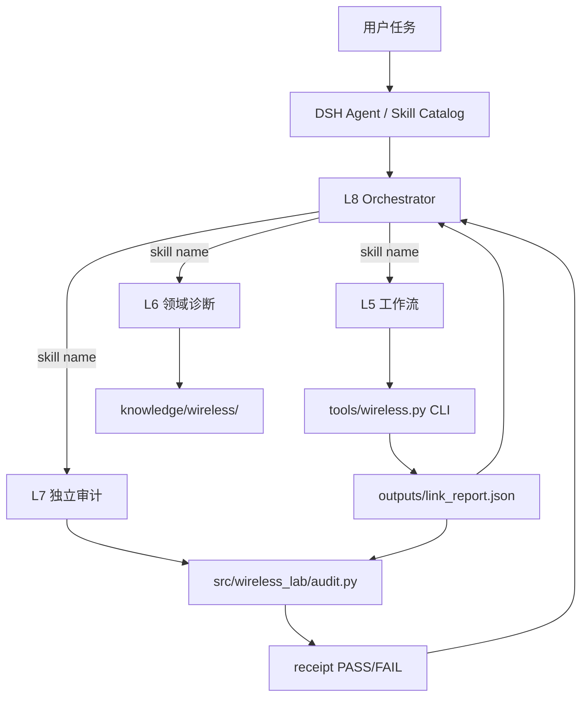

# Wireless Skill Lab v2 — 实施后的架构规范

## A. 核心原则

L1–L8 是教学路径，不是继承树。我们将职责分为六层：**Skills / Knowledge / Tools / Contracts / Artifacts / Evaluation**。以 Skill 装载等同于执行是错误的。知识是阅读资源，脚本是执行工具，跨 Skill 是指令复用；不要用一个机制冒充另一个。

## B. 资源与相对路径

- 项目级知识位于 `knowledge/wireless/*.md`，不是新 Skill。
- `.dsh/skills/<name>/SKILL.md` → `../../../knowledge/wireless/shannon.md` 是从技能目录解析的相对 Markdown 链接。工具从仓库根目录执行时，路径用 `knowledge/wireless/shannon.md`。
- 只有 Skill 根目录的直接子目录 SKILL.md 可被发现；子参考文件是内容资源，不会自动注册。[2]
- 共享 CLI 使用 `python3 tools/wireless.py ...`，入口负责把 `src/` 放进 Python 搜索路径，无需设置 PYTHONPATH。
- `.dsh/skills/*/SKILL.md` 均有独立 `name`、`description`、frontmatter 权限字段。

## C. 三种复用机制

| 类型 | 使用场景 | 接口 | 无法保证什么 |
|---|---|---|---|
| Knowledge reference | 公式、指标和诊断 | 相对 Markdown 路径 + 读文件工具 | 写出路径 ≠ 已阅读 |
| Code / Tool reuse | 计算、验证、路由 | CLI 参数、JSON stdout、exit code | 阅读代码 ≠ 已执行 |
| Cross-Skill composition | 复杂多工作法 | 模型侧 `skill` 工具 + 精确 `name` | 加载指令 ≠ 子任务完成 |

L1 只演示最小自包含公式；L2 只引用共享知识和本包模板；L3–L7 采用具体的代码或知识文件；L8 是专门演示跨 Skill 的总控。

## D. 源数据与报告合同

输入：`data/links.json`，每条记录 `case_id` 唯一、带宽>0、SNR 有限、吞吐>=0。原始字节摘要 SHA256 写入报告，用于源数据变更检查。

计算报告：`outputs/link_report.json`，包含 `schema_version=1`、`method_version=shannon-awgn-v1`、`model`、`source`（path/hash）、`case_count`、`cases`，并固定 `verification_status=UNVERIFIED`。

验证回执：独立 `verify_receipt.json` 和 `audit_receipt.json`，含 status、检查对象、错误清单和数量。对于模型，不允许使用生成报告内的 `UNVERIFIED` 替换为 `PASS`。验证工具 exit 0=PASS、exit 1=FAIL、exit 2=输入/工具错误。

审计器独立实现公式并从原始数据重新计算，不导入 `capacity.calculate` 或报告生成函数。这可以检查源/输出一致性，**但两者仍可能共享错误的理论假设**，不能证明实际物理网络满足 AWGN 模型。

## E. L8 运行机制的边界

`skill(name)` 仅是此图描述的调用意图；Harness 模型侧真正的工具 schema 为 `skill` 的必需 `name` 参数。L8 指令写明了精确名称和停止规则。执行过程：装载 → 按子 Skill 要求真实调用 Bash → 读取 stdout/stderr 与退出码 → 只在 verify/audit PASS 后报告通过。

仅凭 `tools/wireless.py plan` 是**预期执行计划**，不证明 Skill 装载。真实测试要人工导出或保存 DSH 轨迹，按 `eval/EVAL.md` 规范转换，再运行过程评分工具。

## F. 失败、安全与质量

- 源文件只读，不通过修改原始数据来“修复”错误报告。
- 修复预算最多 2 次，超限应终止并报告。
- 工具被禁用、无文件权限或 Skill 不可加载时应写 `NOT_RUN`，不得虚构运行结果。
- 诊断只提出候选假设与只读验证动作；不自动配置基站/无线设备。
- 当前 v2 的 Bash/文件权限取决于用户的实际 Harness 预设，不在 Python 单元测试中验证。

## G. 模式切换

`tools/set_profile.py` 修改 frontmatter。`teaching` 8 个 Skill 都是用户和模型可调用；`integrated` 中 L1/L2 仅用户可调用，L3–L7 仅模型可调用，L8 两边可调用。不要对 L3–L7 设置 `disable-model-invocation: true`，否则 L8 无法加载它们。

## H. 参考

[1] Anthropic, *Skill authoring best practices*（课程源资料）。
[2] DeepSeek Harness, filesystem provider, https://github.com/deepseek-ai/deepseek-harness/blob/master/packages/skill/skill-filesystem/README.zh.md
[3] DeepSeek Harness, model-facing skill loader, https://github.com/deepseek-ai/deepseek-harness/blob/master/packages/skill/tool-skill/README.zh.md
